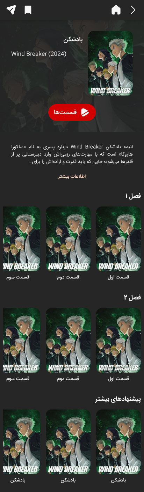
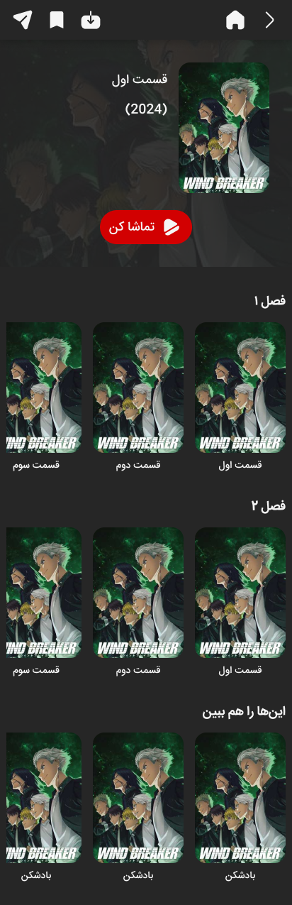
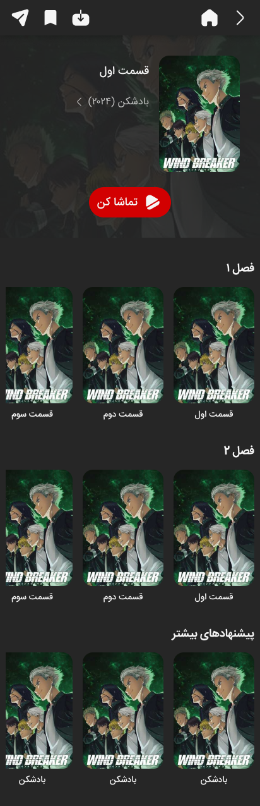
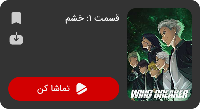
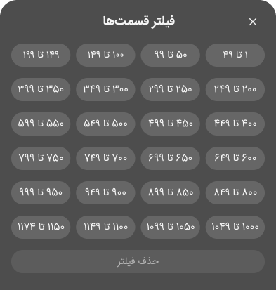
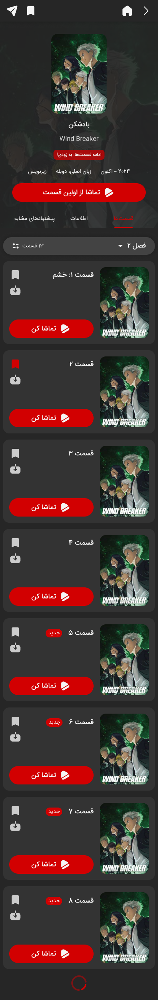
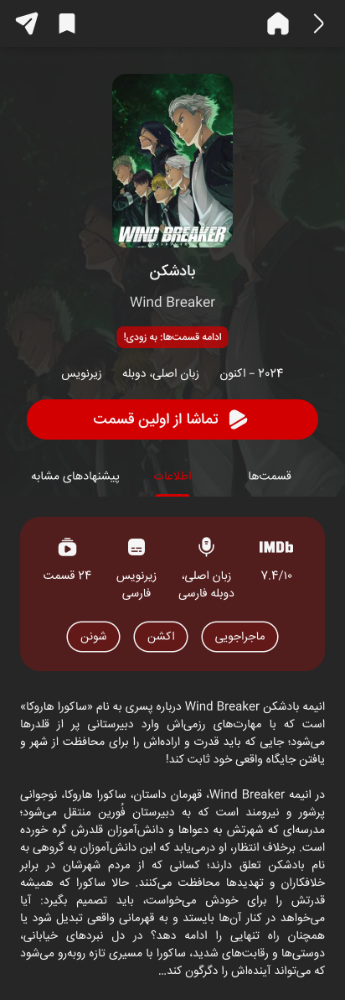
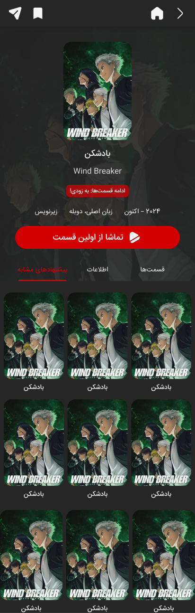

## Funibo: Redesigning the Series Page

[Funibo](funibo.com) is a VOD platform specializing in anime, developed by [Toucan TechGroup](https://toucantechgroup.com/). From 2025 to 2026, I worked as the sole Product Designer of the Toucan team, when the Android app for Funibo was first released. At the time, Funibo's UI was largely copied from [Afarinak](afarinak.com), the company's other VOD product, which is designed for children and already had several usability and visual design issues. Since Funibo targets a teenage audience, simply reusing Afarinak's interface wasn't enough. The two products served different age groups with different needs, calling for a distinct design approach tailored to Funibo's audience.

### The Problem

One of the first UX issues I identified at Toucan was the difficulty of navigating the content catalog, particularly when browsing series. The viewing flow required users to navigate from the series page to an episode page before they could play an episode. Unlike the behavior users might expect from other VOD platforms, selecting an episode cover did not start playback, and there was no direct way to play the series from its main page.

<figure style="margin: 40px;">
    
    <figcaption>Original series page</figcaption>
</figure>

Navigation between episode and series pages was also limited. Episode pages displayed other episodes from the same season in a carousel, but provided no explicit link back to the main series page. This became particularly problematic when users arrived at an episode through a direct link, such as the links behind homepage banners promoting new episodes. In those cases, users had no straightforward way to explore the series or navigate back to its main page.

### Iteration 1: Improving Episode to Series Navigation

As a quick fix for the second issue, which was a common pain point experienced by both users and my coworkers, we added a link to the main series page through the series title on the episode page. This change was also applied to Afarinak. The screens below show the Funibo episode page before (left) and after (right) the change.

  <figure style="margin: 0;">
    
    <figcaption>Episode page: before</figcaption>
  </figure>

  <figure style="margin: 0;">
     
    <figcaption>Episode page: after</figcaption>
  </figure>

### Iteration 2: Simplifying Episode Browsing

I then began redesigning the series page to eliminate the need for a separate episode page and simplify the user flow. During the process, I identified several limitations in the existing design. Horizontal scrolling was less convenient on mobile devices than vertical scrolling, and removing the episode page meant that bookmarking and downloading needed to be accessible directly from the series page for each episode. Additionally, episode titles appeared in the limited space beneath poster-shaped covers, causing most longer names to be truncated and unreadable. These considerations led to the design of a new *Episode Card*, which combined the essential functionality of the episode page into a single component suitable for a vertically stacked list of episodes:

<figure style="margin: 40px;">
    
    <figcaption>Episode card</figcaption>
</figure>

In the original design, seasons were stacked vertically, while episodes were displayed in horizontal carousels. Switching to a vertically stacked episode list required rethinking how users navigated between seasons. Users shouldn't have to scroll through an entire season to reach the next one, so I designed a floating season selector that lets users switch between seasons and see the number of episodes in each. For seasons with more than 21 episodes, the selector also includes a *Filter* button, allowing users to find later episodes without endless scrolling. This feature was designed specifically to accommodate *One Piece*, whose first season contains 1,155 episodes.

  <figure style="margin: 0;">
    
    <figcaption>Floating season selector bar</figcaption>
  </figure>

  <figure style="margin: 0;">
    
    <figcaption>Season select bottom sheet</figcaption>
  </figure>

  <figure style="margin: 0;">
    
    <figcaption>Selector bar with filter button</figcaption>
  </figure>

  <figure style="margin: 0;">
    
    <figcaption>Episode filtering bottom sheet</figcaption>
  </figure>

This redesign also made pagination possible. Previously, the series page displayed all episodes from all seasons simultaneously. With the new layout, only episodes from the selected season need to be loaded, reducing the number of episodes required for the initial page load and enabling pagination within each season.

### Iteration 3: Organizing Series Page

In the original design, the *More Like This* carousel appeared below the season carousels, while the series description was placed below them. With the new episode layout, keeping the two in their original positions no longer made sense. I introduced a tabbed layout to organize these sections, allowing users to switch between episodes, series information, and similar recommendations with a simple tap or horizontal swipe.

We then had to decide which tab users should land on when opening a series page. We wanted to make playback as accessible as possible, while also giving users enough information about a series to decide whether they wanted to watch it. Even when opening the information tab, users would have to read through lengthy descriptions written primarily for website SEO to understand what the series was about. The pages also lacked basic details such as genres, ratings, and audio and subtitle options. To address this, I added a box with the missing info to the information tab and redesigned the page header, adding key details that users could scan at a glance, while also improving the aesthetics. This allowed us to make the episodes tab the default landing, giving users immediate access to playback controls *and* basic context about the series.

  <figure style="margin: 0px;">
    
    <figcaption>Episodes tab</figcaption>
  </figure>

  <figure style="margin: 0px;">
    
    <figcaption>Information tab</figcaption>
  </figure>

  <figure style="margin: 0px;">
    
    <figcaption>More like this tab</figcaption>
  </figure>

### Final Handoff

The redesigned series page brought episode playback, episode-specific actions, season navigation, and series information into a more streamlined experience. To support implementation, I documented the intended interactions and navigation paths in user flow diagrams for handoff to the technical team.

<figure style="margin: 40px;">
    
    <figcaption>Series page user flow</figcaption>
</figure>

© Toucan TechGroup