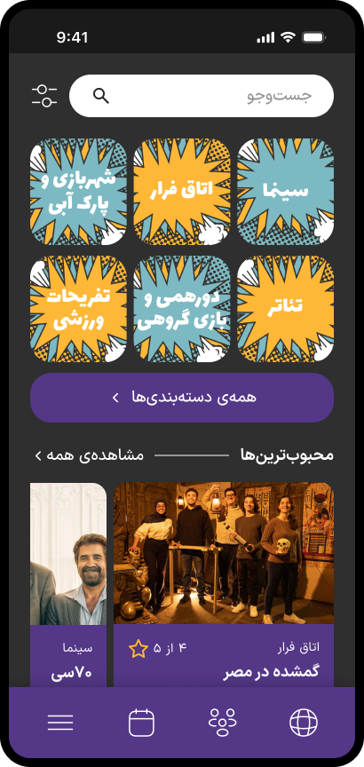
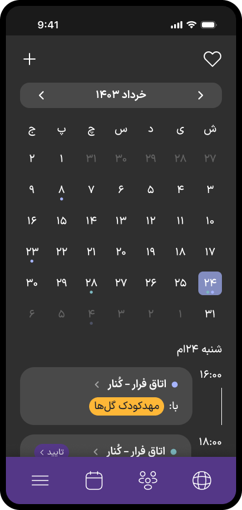
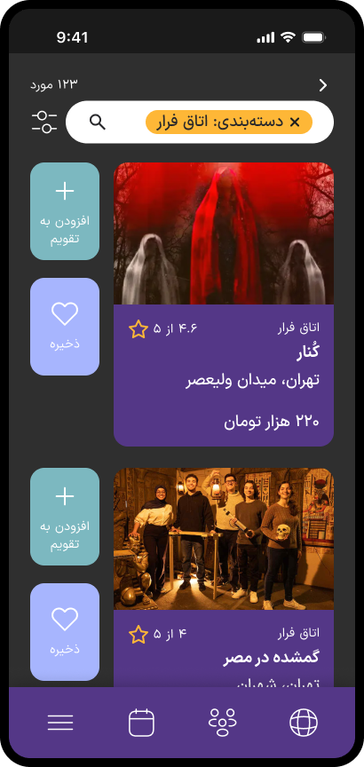

## Kolah

Kolah is a mock social platform for group activities. In this app, you can find and reserve tickets for activities such as movies, escape rooms, workshops, etc. You can create groups with your friends where you can plan and view your calendar, as well as chat and share photos. The app also aimed to assist users in finding teammates for group activities, as a third place for the youth to make friends and experiences.

This project was created for a "Fundamentals of Entrepreneurship" course, where my three person team was required to come up with a business idea and deliver a Business Model Canvas and MVP for it. Aside from the UI design and prototyping in Figma, the branding, including our logo, color palette, and graphical elements, was also designed by me.

  

[Design Board on Figma](https://www.figma.com/design/Yg4huGlqJELoHLXNCpdbHY/Kolah?node-id=118-914&t=DiTaqzqyRPyIsMsL-1)

© Mahya Zarrabi-Zadeh