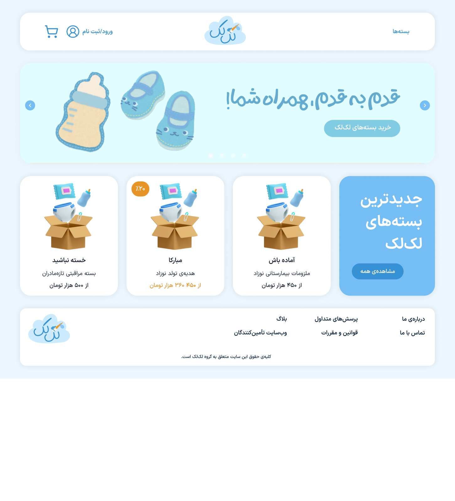
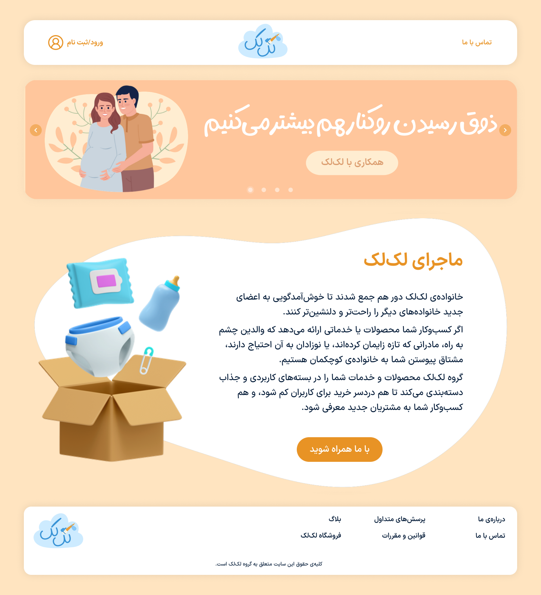

## LakLak Co.

LakLak is a mock-startup offering bundles of necessary products and services for expecting and new parents. This e-commerce project consists of two platforms: the main website, for customers, and the suppliers website. The distinction of platforms was achieved by switching the primary and secondary color of the brand color palette.

This project was created for a "System Design and Analysis" course. Along with the UI Design, all of the branding material for this mock-business was also designed by me.

 

[Design Board on Figma](https://www.figma.com/design/2NZL5fwLGMzItjyGICY8wO/LakLak?node-id=507-2&t=Yutaem40SPGjrazc-1)

© Mahya Zarrabi-Zadeh